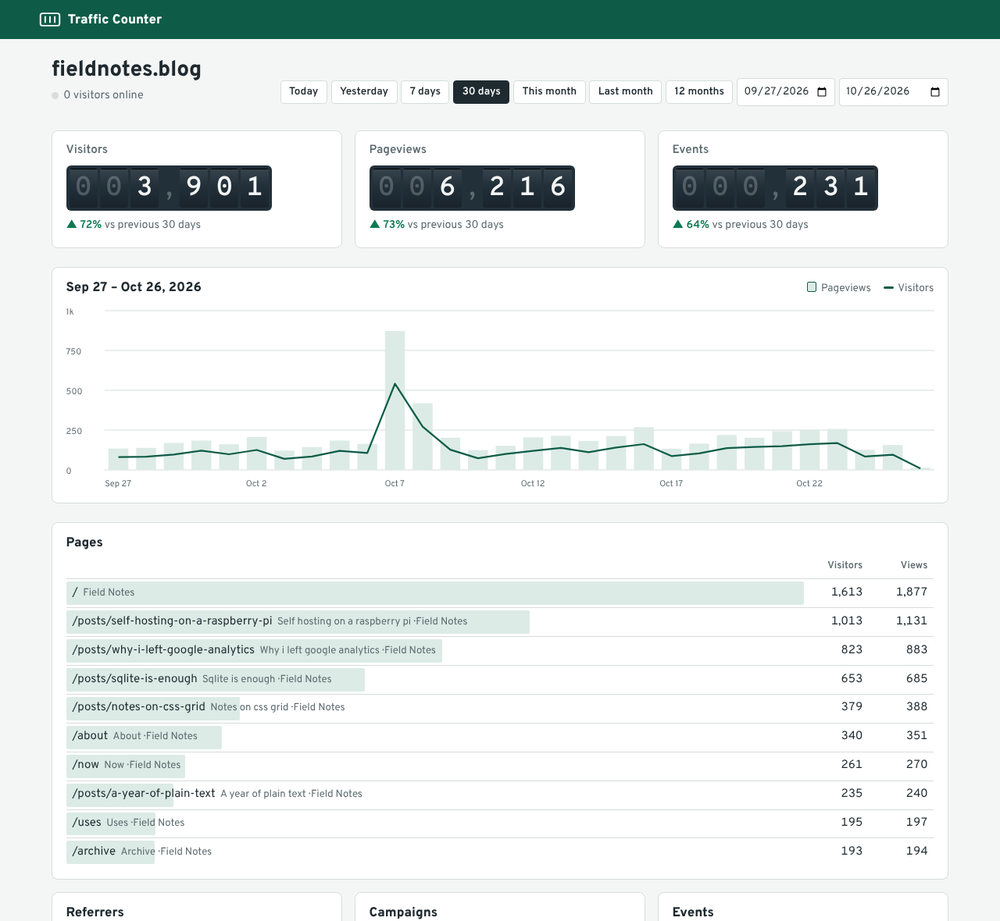

# Traffic Counter

Privacy-friendly web analytics and visit counter for all your sites — one small Node.js server, one SQLite file, **zero dependencies**.



- **No cookies, no consent banner.** IPs and user agents are never stored. Unique visitors are counted with a salted hash that is thrown away every day.
- **One snippet, every site.** Add as many sites as you like to one server.
- **Visit counter badges.** Show a live view count on any page, as an SVG badge or JSON.
- **Public dashboards.** Share read-only stats with a link if you want to.
- **Tiny tracker.** About 2 KB compressed, works with single-page apps, counts click events.
- **Your data.** Export to CSV any time, import from GoatCounter, set automatic retention.
- **Easy to run.** `node` + a folder. No database server, no build step, no `npm install`.

## Quick start

You need [Node.js](https://nodejs.org) 22.13 or newer.

```sh
git clone https://github.com/bawcejawn/Traffic-Counter.git
cd Traffic-Counter
npm start
```

Open <http://localhost:8080>, create your account, add a site, and paste the snippet it gives you into your pages:

```html
<script async src="https://stats.example.com/t.js" data-site="YOUR_SITE_KEY"></script>
```

Visits appear in the dashboard within seconds.

Want to look around first? Load demo data:

```sh
DB_PATH=./data/demo.db node scripts/demo-data.js
DB_PATH=./data/demo.db npm start     # log in with demo@example.com / demo-password
```

### With Docker

```sh
docker compose up -d
```

Data is kept in `./data/traffic.db`. Back up that one file and you've backed up everything.

## Putting it online

Run it on any small VPS, home server or Raspberry Pi and put it behind HTTPS. With [Caddy](https://caddyserver.com) that's two lines:

```
stats.example.com {
    reverse_proxy localhost:8080
}
```

Then start Traffic Counter with `TRUST_PROXY=1` so it sees real visitor IPs (needed for unique-visitor counting) and marks cookies `Secure`.

**Countries:** Traffic Counter does not ship a GeoIP database. If you put the server behind Cloudflare, set `COUNTRY_HEADER=cf-ipcountry` and countries show up automatically. Any proxy that adds a country-code header works the same way.

### Configuration

| Variable | Default | What it does |
|---|---|---|
| `PORT` | `8080` | Port to listen on |
| `HOST` | `0.0.0.0` | Address to bind |
| `DB_PATH` | `./data/traffic.db` | Where the SQLite database lives |
| `TRUST_PROXY` | off | Read the visitor IP from `X-Forwarded-For` / `CF-Connecting-IP`. Turn on only behind a proxy. |
| `COUNTRY_HEADER` | — | Request header holding a 2-letter country code, e.g. `cf-ipcountry` |
| `SECURE_COOKIES` | auto | Force `Secure` login cookies on (`1`) or off (`0`) |

## Tracking

### Pages

The snippet counts a pageview on load, and again on every client-side navigation (`pushState`, back/forward) in single-page apps. Pages being prerendered are only counted once they're actually shown.

### Events

```html
<button data-tc-event="signup">Sign up</button>
```

```js
window.tc.event('newsletter-subscribed');
window.tc.pageview({ path: '/virtual/step-2' });
```

### Script options

Add these attributes to the `<script>` tag:

| Attribute | Effect |
|---|---|
| `data-outbound` | Count clicks on links to other sites as events |
| `data-respect-dnt` | Skip visitors who send Do Not Track or Global Privacy Control |
| `data-hash` | Treat `#section` changes as separate pages |
| `data-manual` | Don't count automatically; call `tc.pageview()` yourself |
| `data-no-spa` | Don't count `pushState` navigations |
| `data-allow-local` | Count visits on `localhost` (for testing) |
| `data-debug` | Log to the console why a visit wasn't counted |
| `data-endpoint` | Send hits to a different URL |

### Without JavaScript

```html

```

### Campaigns

Links with `?utm_source=`, `?utm_medium=`, `?utm_campaign=` (or the short `?ref=`) are recorded as campaigns and referrers.

### Ignoring your own visits

Open any page of your site with `#tc-ignore` at the end of the address. That browser is no longer counted; do it again to undo. You can also list paths to skip (like `/admin`) in the site settings.

## Visit counter badge

```html

```

| Parameter | Values |
|---|---|
| `path` | Page path; leave out for the whole site |
| `metric` | `views` (default) or `visitors` |
| `label` | Text on the left, or empty for a number only |
| `color` | `teal`, `green`, `blue`, `purple`, `orange`, `red`, `gray`, `black` or a hex color |
| `labelColor` | Hex color for the label side |
| `compact` | `1` for `12.3k` instead of `12,345` |
| `style` | `flat` (default) or `square` |

Need the number for your own design? `GET /counter/YOUR_SITE_KEY.json?path=/` returns `{"path":"/","views":123,"visitors":45}`. Both endpoints allow cross-origin requests and can be turned off per site.

## How visitors are counted

For each hit the server computes

```
sha256(daily_salt + site + ip + user_agent)
```

and remembers that hash only until the end of the UTC day. The hit row itself gets two flags — *first hit of this visitor today* and *first hit of this visitor on this page today* — and nothing else that identifies the visitor. When the day rolls over, the salt and every hash are deleted, so visits can't be linked across days, not even by whoever runs the server.

That means "visitors" over a range is the sum of daily unique visitors, similar to how other cookie-free analytics tools count.

What is stored per hit: time, path, page title, referrer host and path, UTM fields, browser and major version, OS, device class, screen size bucket (not the exact size), country (if your proxy provides it) and primary language.

Bots, crawlers, link previewers, headless browsers and prefetches are filtered out.

## API

All dashboard data comes from a JSON API (log in first; the session cookie authenticates).

| Endpoint | |
|---|---|
| `GET /api/sites` | Your sites |
| `GET /api/sites/:id/stats?from=YYYY-MM-DD&to=YYYY-MM-DD` | Totals, previous-period totals, time series and all breakdowns |
| `GET /api/sites/:id/breakdown/:name?offset=&limit=` | One breakdown, paginated: `pages`, `refs`, `campaigns`, `events`, `browsers`, `systems`, `devices`, `screens`, `countries`, `languages` |
| `GET /api/sites/:id/live` | Visitors active in the last 5 minutes |
| `GET /api/sites/:id/export.csv` | Every hit as CSV |
| `GET /api/public/:key/stats` | Same as stats, for sites with a public dashboard |

Stats and breakdowns take filters as query parameters: `path`, `ref`, `campaign`, `source`, `medium`, `browser`, `os`, `device`, `screen`, `country`, `language`.

## Command line

```sh
node bin/traffic-counter.js add-user you@example.com 'long-password'
node bin/traffic-counter.js reset-password you@example.com 'new-password'
node bin/traffic-counter.js sites
node bin/traffic-counter.js import-goatcounter SITE_KEY goatcounter-export.csv.gz
```

## Coming from GoatCounter

Traffic Counter was inspired by [GoatCounter](https://github.com/arp242/goatcounter) and written from scratch. Compared with it:

- **Zero dependencies.** Nothing to compile and no database server; Node's built-in SQLite does the storage.
- **Privacy by construction.** Visitor hashes never reach the `hits` table and are deleted daily, together with their salt.
- **Visit counter badges** with styling options, not just a plain count.
- **SPA support and click events built in** — no extra code needed for `pushState` routers.
- **Live "visitors online" indicator** and click-to-filter on every breakdown.
- **iPadOS detection**, prefetch/prerender filtering and a domain allow-list per site.
- **Permissive MIT license** for the whole project.
- **Import** your GoatCounter history: export a CSV from GoatCounter, then run `import-goatcounter`.

GoatCounter is more mature and has features this doesn't (yet): multiple users per site with roles, email reports, API tokens and a hosted service.

## Development

```sh
npm run dev     # restarts on file changes, uses ./data/dev.db
npm test
```

The server is in `src/`, the dashboard (plain JavaScript, no build) and tracker in `public/`.

## License

MIT. The bundled Overpass fonts are under the SIL Open Font License.
